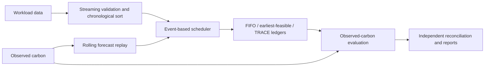

# TRACE — Temporal Risk-aware Adaptive Carbon Engine

TRACE is a research prototype for scheduling flexible compute tasks against changing electricity carbon intensity. It compares FIFO, earliest-feasible, and forecast-guided TRACE scheduling under CPU capacity and delay constraints. The full Phase 6 simulation and independent ledger reconciliation are complete.

## Problem

Some workloads can tolerate bounded delay. If a lower-carbon execution window is forecast and capacity is available, moving a task may reduce its estimated operational emissions. TRACE tests this idea with a rolling forecast replay and an uncertainty penalty, then evaluates scheduled tasks against observed carbon intensity.

## Contributions

- Streaming validation, deterministic task IDs, external chronological sort, and disk-backed duplicate detection.
- Non-preemptive event-based scheduler with FIFO, earliest-feasible, and forecast-guided policies.
- SQLite checkpointing, output-offset recovery, and resumable execution.
- Evaluation on 13,288,830 tasks with independent ID, ledger, checkpoint, constraint, and emissions checks.
- Explicit reporting of forecast coverage, fallback reasons, unequal completed populations, and a common-task emissions comparison.

## Architecture



TRACE uses forecasts to rank feasible candidate starts. Its final emissions calculation uses observed carbon, not forecasts. The policy score is a local heuristic, not a global optimizer.

## Technology

Python 3.10+, pandas, NumPy, scikit-learn, Matplotlib, psutil, SQLite, and pytest. The verified test environment was Python 3.13.3 on Windows.

## Repository map

```text
src/data/          workload, carbon, energy, and validation utilities
src/forecasting/   Seasonal Naive and other forecasting methods
src/scheduler/     scheduling policies, event engine, constraints, preflight
src/evaluation/    forecast metrics, scheduler evaluation, Phase 6 runner
scripts/           validation/reconciliation utilities and benchmarks
tests/             unit, integration, recovery, and evaluation tests
docs/              scientific reports, architecture, recovery, and runbooks
data/              local raw and processed data (ignored by Git)
results/           local forecasts, validation, outputs, and checkpoints (ignored)
```

## Data

The principal experiment uses a cleaned workload of 13,288,830 tasks and 216 hourly IN-WE carbon observations dated 2026-09-22 to 2026-09-30 UTC. The validated workload is externally sorted and carries deterministic `source_row`/`task_id` identities. Forecast replay records cover 40 origins and four hourly leads. The raw workload, carbon CSV, ordered workload, forecast CSV, full run outputs, and validation artifacts are local ignored files; they are not included in a clean Git clone. Reproduction requires supplying these inputs. The main carbon file's original retrieval URL, retrieval date, API version, and license are not fully documented. Separate January 2025 half-hour carbon files have unverified zone/units and are not combined with the main series.

## Forecasting

The persisted evaluation forecast uses a 24-hour Seasonal Naive rule at four rolling leads. Its 160 historical replay predictions have all-lead MAE 6.125 and RMSE 6.946 gCO2e/kWh. Observed interval coverage is 100% on this short correlated sample, which does not demonstrate formally calibrated future uncertainty or operational forecast availability. See [forecast validation](docs/TRACE_FORECASTING_VALIDATION.md).

## Scheduling and energy model

- FIFO preserves chronological task order and finds feasible slots without overtaking committed starts.
- Earliest-feasible selects the earliest capacity-feasible slot and can backfill.
- TRACE ranks feasible hourly starts using predicted carbon savings reduced by a forecast-uncertainty penalty, with earliest-feasible fallback.
- All policies are non-preemptive and enforce 8-core capacity, release time, and a 3,600-second maximum delay in the Phase 6 experiment.
- Energy uses `duration_seconds × cpu_cores × 10 W/core ÷ 3,600,000`. Ten W/core is an assumption, not measured system power.
- Final emissions use observed hourly IN-WE carbon intensity, with energy allocated proportionally across occupied hours.

## Phase 6 verified results

| Strategy | Processed | Completed | Deferred | Infeasible | Observed emissions on own completed tasks |
|---|---:|---:|---:|---:|---:|
| FIFO | 13,288,830 | 297,143 | 12,991,615 | 72 | 9,176.9781 g CO2e |
| Earliest-feasible | 13,288,830 | 313,268 | 12,975,490 | 72 | 9,226.8921 g CO2e |
| TRACE | 13,288,830 | 313,268 | 12,975,490 | 72 | 9,226.7090 g CO2e |

The strict common completed population contains 165,474 IDs. Its observed emissions are 4,553.7721 g for FIFO, 4,553.7716 g for earliest-feasible, and 4,553.5885 g for TRACE. TRACE is 0.00403% below FIFO on that common population; the difference is small and does not establish general superiority. The full completed-task populations differ, so whole-outcome totals must not be interpreted as a like-for-like comparison.

All three ledgers independently passed 13,288,830 row and unique-ID checks, with zero missing, duplicate, unexpected, sequence, or source-row identity errors. Sizes agree with checkpoint offsets; constraint audit violations are zero. Row-wise energy and observed-carbon recalculation passed. TRACE had 1,699,114 replay-eligible tasks, 11,649,044 fallback decisions (with recorded reasons), and three forecast-rescheduled decisions. These are distinct measures. Full run duration and recovery caveats are documented in the execution report.

## Install and test

```cmd
py -3.13 -m venv .venv
.venv\Scripts\activate
py -m pip install -r requirements.txt
py -m pytest -q -o cache_dir=C:\TRACE_pytest_cache --basetemp=C:\TRACE_test_temp
```

Verified result: 93 passed; one third-party `dateutil` deprecation warning. Create writable pytest temp/cache directories on systems where these paths do not exist.

## Safe commands

Validate and externally sort the supplied workload (disk-intensive, no scheduler run):

```cmd
py -m src.data.validate_workload_stream --input data/processed/workload/workload_cleaned.csv --carbon data/raw/carbon/india_west_carbon_intensity.csv --zone IN-WE --output-dir results/validation
```

Validate forecast replay (does not run the scheduler):

```cmd
py -m src.evaluation.forecast_validation --carbon data/raw/carbon/india_west_carbon_intensity.csv --forecasts results/forecasting/rolling_seasonal_naive_forecasts.csv --workload results/validation/chronological_tasks.csv --output results/forecasting
```

Run preflight without scheduling (explicitly bounded):

```cmd
py -m src.scheduler.preflight --workload results/validation/chronological_tasks.csv --carbon data/raw/carbon/india_west_carbon_intensity.csv --forecasts results/forecasting/rolling_seasonal_naive_forecasts.csv --output results/simulation/preflight_only --max-tasks 1000 --minimum-free-gb 5
```

For staged runs, recovery, and the explicit full-scale command, read [the reproducibility runbook](docs/TRACE_REPRODUCIBILITY_AND_RUNBOOK.md). **Do not run an unbounded full simulation as a quick test:** it processes 13.29 million rows and writes multi-gigabyte ledgers and checkpoint state. Use a new output directory and verify inputs/disk first.

## Documentation

- [Final project audit](docs/TRACE_FINAL_PROJECT_AUDIT.md)
- [Carbon data provenance audit](docs/TRACE_CARBON_DATA_PROVENANCE.md)
- [Carbon hash reconciliation](docs/TRACE_CARBON_HASH_RECONCILIATION.md)
- [Phase 8 submission readiness](docs/TRACE_PHASE8_SUBMISSION_READINESS.md)
- [Team information to complete](submission/TEAM_INFORMATION_TO_COMPLETE.md)
- [Reproducibility archive and manifest](submission/TRACE_REPRODUCIBILITY_ARCHIVE/ARCHIVE_README.md)
- [Scientific methodology and results](docs/TRACE_SCIENTIFIC_METHODOLOGY_AND_RESULTS.md)
- [Final academic report](docs/TRACE_FINAL_REPORT.md)
- [Reproducibility and runbook](docs/TRACE_REPRODUCIBILITY_AND_RUNBOOK.md)
- [Phase 6 execution record](docs/TRACE_PHASE6_EXECUTION.md)
- [Final evaluation](docs/TRACE_FINAL_EVALUATION.md)
- [Final presentation](docs/TRACE_FINAL_PRESENTATION.md)
- [Technical demo script](docs/TRACE_DEMO_SCRIPT.md)
- [Forecast validation](docs/TRACE_FORECASTING_VALIDATION.md)
- [Architecture](docs/TRACE_SCHEDULER_ARCHITECTURE.md)
- [Checkpoint and recovery](docs/TRACE_CHECKPOINT_AND_RECOVERY.md)
- [Data validation and scalability](docs/TRACE_DATA_VALIDATION_AND_SCALABILITY.md)

## Limitations and next steps

The model uses assumed power, a short historical replay, incomplete source provenance, and an index-based workload/carbon timeline. It excludes facility energy, hardware embodied emissions, and several resource constraints. The result is a constrained simulation rather than measured production savings. Future work should use longer provenance-complete carbon histories, record live forecast issue times, measure system energy, test more workloads and regions, and evaluate uncertainty under temporal shift.
