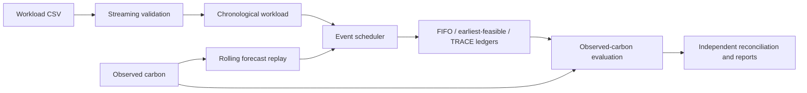

# TRACE Final Presentation

## Slide 1 — TRACE: Carbon-Aware Scheduling Under Constraints

- Temporal Risk-aware Adaptive Carbon Engine
- University project: scheduling prototype, rolling forecast replay, and full-scale simulation
- Team: [TEAM MEMBER 1 — FULL NAME]; [TEAM MEMBER 2 — FULL NAME]
- Institution/department: [INSTITUTION / DEPARTMENT]
- Supervisor: [SUPERVISOR NAME, IF REQUIRED]

**Suggested visual:** Title over a simple timeline of changing carbon intensity and queued tasks.

**Speaker notes:** TRACE asks whether a small amount of deadline-bounded scheduling flexibility can move compute away from higher-carbon hours while preserving CPU capacity constraints. The results are simulation estimates, not measured server emissions.

## Slide 2 — Why Scheduling Time Matters

- Grid carbon intensity changes by hour.
- Some compute tasks can wait within a deadline.
- A feasible task may therefore have multiple start times and different estimated emissions.

**Suggested visual:** Carbon-intensity line with two feasible task slots.

**Speaker notes:** Carbon-aware scheduling is a demand-shifting idea. TRACE tests only time shifting for this workload; it does not shift geography or model grid causality.

## Slide 3 — Research Objectives

- Build a reproducible event-based scheduler with three policies.
- Use a rolling forecast replay and an explicit uncertainty penalty.
- Compare completion, delay, capacity, energy, and observed-carbon outcomes.
- Independently audit full-scale ledger identity and recovery.

**Suggested visual:** Objectives mapped to implementation, experiment, and evidence.

**Speaker notes:** Independent verification matters because engine summaries alone do not prove complete output identity coverage.

## Slide 4 — Workload and Carbon Data

- 13,288,830 validated chronological task rows.
- 216 continuous hourly IN-WE carbon observations, 2026-09-22 to 2026-09-30 UTC.
- 72 task requests exceed the configured 8-core capacity.
- Workload seconds map to carbon row indices; calendar alignment is assumed.

**Suggested visual:** Dataset cards and a 9-day timeline.

**Speaker notes:** Main carbon-source retrieval metadata is incomplete. Separate January 2025 half-hour files have unverified zone/units and are excluded.

## Slide 5 — Preparation and Validation

- Stream validation, deduplication, stable source-row IDs.
- External chronological sort by release time and task ID.
- Zero invalid or duplicate tasks in the final validated population.
- 72 over-capacity requests remain visible for infeasible classification.

**Suggested visual:** Raw workload → validation → chronological ledger.

**Speaker notes:** Sorting is external/disk-backed, and task identity is deterministic: `trace-task-{source_row:012d}`.

## Slide 6 — Forecast Replay

- 24-hour Seasonal Naive: target value copied from 24 hours earlier.
- Four forecast leads at each recorded historical origin.
- 40 origins and 160 prediction rows.
- Historical replay, not verified live forecast availability.

**Suggested visual:** One origin, four horizons, seasonal source points 24 hours earlier.

**Speaker notes:** The saved replay stops near the end of the short carbon series. Eligibility is complete coverage for a task's baseline occupied hours at its selected historical origin.

## Slide 7 — Forecast Validation Findings

- All-lead MAE: 6.125 gCO2e/kWh; RMSE: 6.946.
- Persistence all-lead MAE: 45.388.
- Interval coverage: 100% over 160 correlated predictions.
- 43 calibration residuals; no claim of formal future calibration.

**Suggested visual:** MAE by horizon and interval-coverage caution callout.

**Speaker notes:** The replay is short and temporally dependent. The observed coverage does not prove that nominal 90% intervals will maintain future coverage.

## Slide 8 — System Architecture

**Suggested visual:** Use the Mermaid diagram above.

**Speaker notes:** The forecast guides TRACE decisions, while the observed carbon series evaluates emissions after scheduling.

## Slide 9 — Scheduling Decision Logic

- Non-preemptive tasks use a shared event calendar.
- Enforce release time, 8-core capacity, and 3,600-second maximum delay.
- TRACE scores hourly candidate starts with predicted savings minus an uncertainty penalty.
- No positive feasible candidate → earliest-feasible fallback with a reason.

**Suggested visual:** Candidate starts → forecast score → feasibility filter → chosen start/fallback.

**Speaker notes:** The ranking is a per-task heuristic, not a global emissions optimizer. The score's uncertainty term is not a calibrated probability.

## Slide 10 — Baseline Comparison Method

- FIFO preserves arrival/start order with an earliest feasible slot.
- Earliest-feasible places each task at its earliest slot and can backfill.
- TRACE applies forecast ranking and the same capacity/deadline constraints.
- All methods process identical stable IDs and are evaluated on observed carbon.

**Suggested visual:** Three policy lanes over the same arrivals and capacity timeline.

**Speaker notes:** Population size matters. We report each method's own completed tasks and a strict common completed-ID set.

## Slide 11 — Energy and Carbon Model

- Energy = duration × allocated cores × 10 W/core ÷ 3,600,000.
- 10 W/core is an assumption, not measured power.
- Allocate energy across occupied hours by runtime overlap.
- Emissions = allocated energy × observed gCO2e/kWh.

**Suggested visual:** Task interval crossing hourly carbon bars.

**Speaker notes:** Idle server energy, memory, cooling, and facility overhead are excluded. Predictions never replace observed intensities in final emissions.

## Slide 12 — Full-Scale Engineering Result

- 13,288,830 tasks processed by each strategy.
- Three ledgers total 7.96 GB; checkpoint database 920 MB.
- Recorded peak RSS: 106.5 MiB; scheduler runtime: 10,127 s.
- Durable checkpoint recovery completed; independent ID and offset checks passed.

**Suggested visual:** Task volume, elapsed scheduler work, memory, and disk metrics.

**Speaker notes:** The scheduler runtime excludes the interruption gap. Full-scale outputs and verification artifacts are local and ignored by Git.

## Slide 13 — Experimental Results

| Policy | Completed | Deferred | Infeasible | Observed emissions |
|---|---:|---:|---:|---:|
| FIFO | 297,143 | 12,991,615 | 72 | 9,176.9781 g |
| Earliest-feasible | 313,268 | 12,975,490 | 72 | 9,226.8921 g |
| TRACE | 313,268 | 12,975,490 | 72 | 9,226.7090 g |

**Suggested visual:** Side-by-side completions and emissions with denominators shown.

**Speaker notes:** Whole-population emissions are not directly comparable because FIFO completes fewer tasks. All methods have zero pending tasks at finalization.

## Slide 14 — Common Population and Interpretation

- 165,474 task IDs completed by all three policies.
- Common-set emissions: FIFO 4,553.7721 g; earliest 4,553.7716 g; TRACE 4,553.5885 g.
- TRACE is 0.1836 g (0.00403%) below FIFO on this set.
- This tiny difference does not establish broad or material superiority.

**Suggested visual:** Common-population emissions with a magnified, labeled difference.

**Speaker notes:** The common set removes the unequal-completion denominator issue, but the remaining difference is small and specific to this data/configuration.

## Slide 15 — Limits, Next Work, and Conclusion

- Replay availability, carbon provenance, timeline mapping, and 10 W/core are limitations.
- No measured energy or production deployment claim.
- Expand carbon history, log live forecast issue times, measure hardware energy, and calibrate uncertainty.
- TRACE completed the full simulation and passed independent ledger reconciliation.

**Suggested visual:** Current evidence → validation gaps → next experiments.

**Speaker notes:** The project demonstrates a tested scheduling and recovery pipeline. Results support careful comparison on this run, not a universal claim that TRACE is better.
